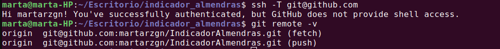
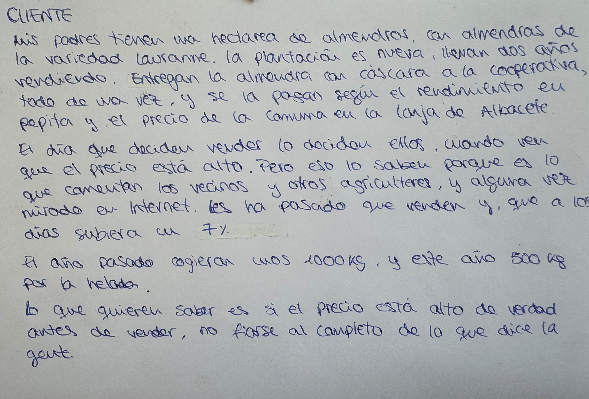
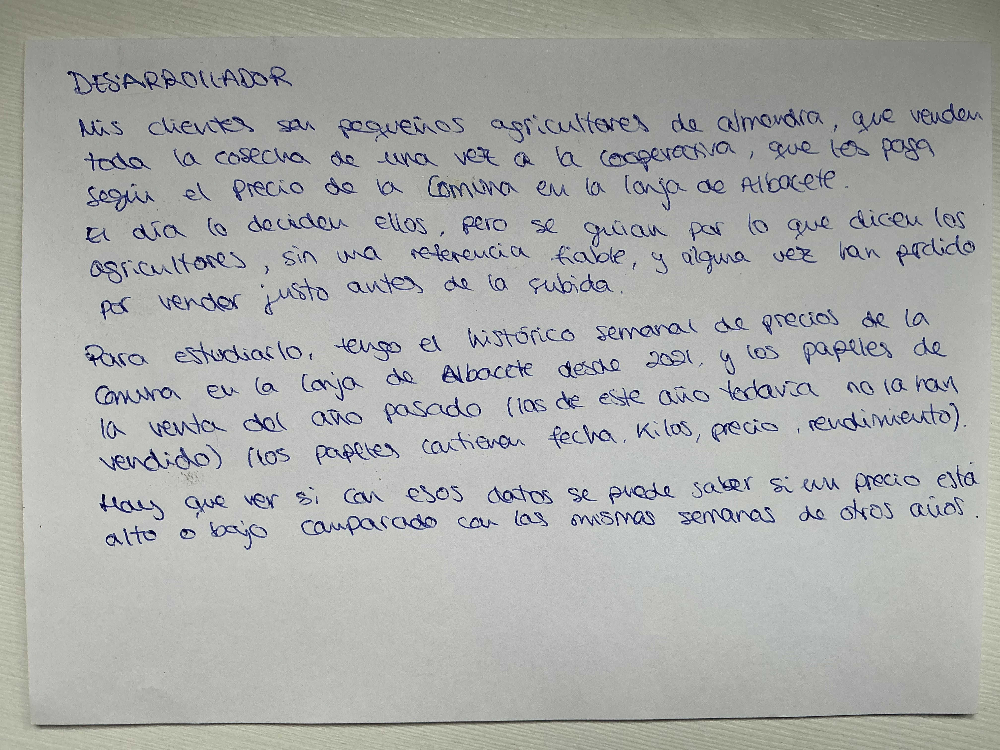
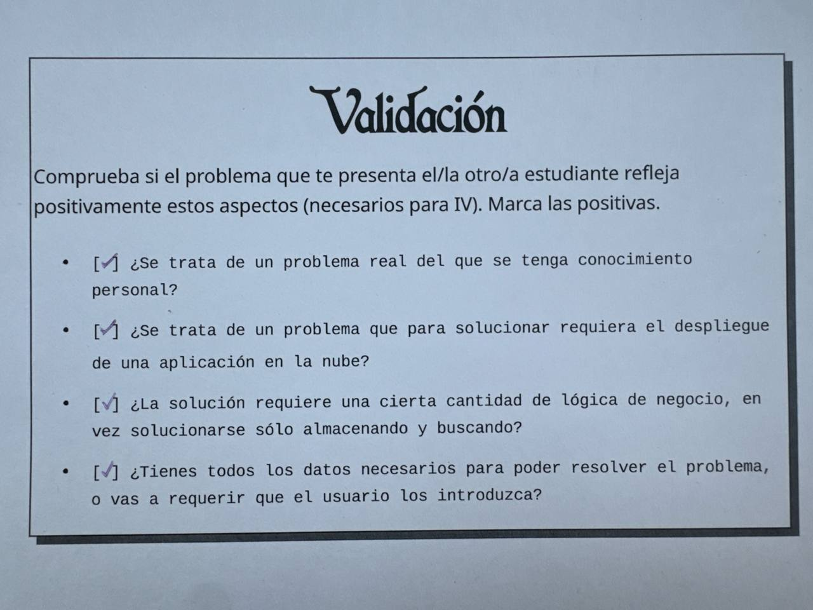

# Configuración del entorno de desarrollo y repositorio

En este documento detallo las decisiones y herramientas de configuración utilizadas para desarrollar el proyecto **IndicadorAlmendras**.

## 1. Identidad en Git
He configurado git con mi nombre y con el correo de mi cuenta de GitHub, así los commits que hago salen a mi nombre:
* `user.name`: Configurado con mi nombre.
* `user.email`: Configurado con el correo vinculado a mi cuenta de GitHub.

## 2. Autentificación y conexión segura (SSH)
Para la sincronización con los repositorios remotos en GitHub empleo exclusivamente autentificación mediante par de claves SSH (`id_ed25519`):
* La clave pública se encuentra subida en GitHub.
* Se rechaza el protocolo HTTPS y el uso de contraseñas en texto plano por motivos de seguridad y conforme a las directrices de la asignatura. Así no se tiene que meter la contraseña cada vez y es más seguro.

## 3. Perfil de GitHub
Mi perfil de GitHub tiene avatar propio (no el predeterminado), mi nombre y ciudad.

## 4. Licencia de Software Libre
El proyecto se distribuye bajo los términos de la licencia libre GPL-3.0 (fichero [`LICENSE`](../LICENSE) en la raíz del repositorio), garantizando la transparencia del código, la libre distribución y el cumplimiento de los estándares de software libre exigidos.

## 5. Juego de rol (design thinking)

